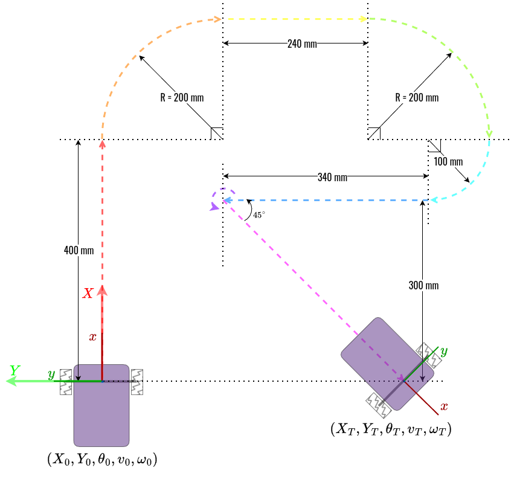
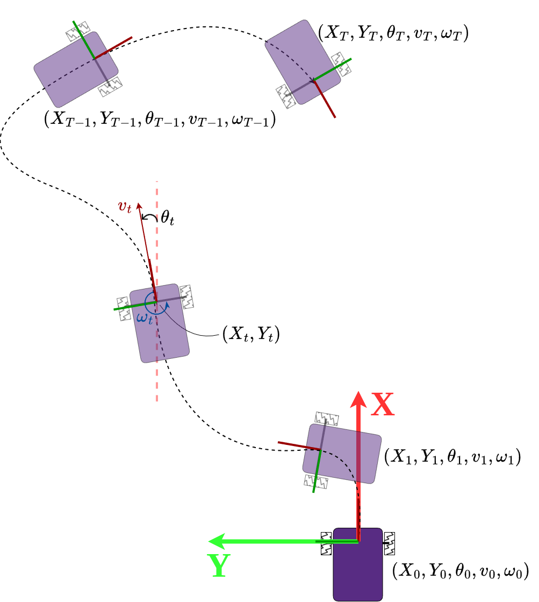

# Track Robot's Trajectory

## 1. Overview
For any mobile robot, moving accurately along a pre-planned trajectory while localizing itself is a fundamental capability. 
In this assignment, you will control a differential-drive robot's motion by sending scheduled linear and angular velocity commands, recording odometry data, and evaluating tracking performance. 

### Preparation
1. Set up the differential drive mobile base.
   1. *(Recommended)* Install the mobile robot [software stack](https://github.com/linzhangUCA/upython_mobile_robot/tree/main/src/upyton_mobile_robot) on Raspberry Pi Pico 2.
   2. Update the configuration properties to match your robot's physical dimensions.
   3. Tune the PID parameters so the robot responds quickly and smoothly to velocity commands.
2. (Optional, [VSCode](https://code.visualstudio.com/) recommended) Configure Python environment for the trajectory plotting code:
    1. Install [uv](https://docs.astral.sh/uv/getting-started/installation/) **on your computer**.
    2. Open a terminal in your local assignment repository and run `uv sync` to install the required dependencies ([Matplotlib](https://matplotlib.org/stable/) and, if needed, [PyQt6](https://pypi.org/project/PyQt6/)).
    3. Run Python scripts **on your computer** using `uv run <script_name>.py` (for example, `uv run plot_traj.py`).

## 2. Requirements
Your robot must autonomously track the pre-defined trajectory (indicated by the dashed lines) shown in the figure below. 
The path is divided into **8 color-coded segments**. 
For each segment, you will command the robot using a constant linear velocity ($v$) and angular velocity ($\omega$) for a fixed duration ($\Delta T$).



### 2.1. Plan Trajectory Tracking
Document your calculations for the velocity commands and duration of **each segment** in [README.md](README.md):
- State the kinematic equations used and show your numerical substitutions to determine the **linear velocity command ($v$)** for each segment.
- State the kinematic equations used and show your numerical substitutions to determine the **angular velocity ($\omega$) command** for each segment.
- State the equations used and show your numerical substitutions to determine the **duration** of each segment.

> [!IMPORTANT]
> - Total travel time must not exceed **60 seconds** (excluding pauses at checkpoints).
> - Account for your robot's physical limits (e.g., maximum wheel speed and turning constraints) when selecting velocities.
> - Format all mathematical expressions using GitHub's [math syntax guide](https://docs.github.com/en/get-started/writing-on-github/working-with-advanced-formatting/writing-mathematical-expressions).

### 2.2. Implement Trajectory Tracking
1. Enter your planned velocity commands and segment durations into [track_traj.py](track_traj.py).
2. Run [track_traj.py](track_traj.py) on the Pico using **MicroPython** to execute the trajectory tracking and log motion data.
3. Transfer the recorded data file (`vel_data.csv`) from the Pico to the [data/](./data/) directory in your local repository and push it to GitHub.
4. Complete code in [plot_traj.py](plot_traj.py) to estimate the robot's pose at every time step.
5. Run [plot_traj.py](plot_traj.py) on your computer using **local Python** to generate the measured trajectory plot.
6. Save the generated figure in the [images/](./images/) directory, push it to GitHub, and embed it in [README.md](README.md).

> [!IMPORTANT]
> - Modifying code outside the designated sections is not recommended.
> - Be mindful of the Pico's flash storage limit (**4 MB** maximum).

### 2.3. Demonstrate the Trajectory Tracking Robot
Demonstrate your robot to Dr. Zhang on the designated test course:
The endpoint of each segment serves as a **checkpoint**. There are **7 checkpoints** in total (the 7th purple segment is an in-place rotation with no translation).
At each checkpoint, the Euclidean distance error $d$ (in meters) between the robot's actual stopping position and the target checkpoint will be measured.
Grade penalties ($p$) will be deducted based on $d$:

```math
p =
\begin{cases}
   0, & \text{if } d \leq 0.05 \\
   50d, & \text{otherwise}
\end{cases}
```

> [!CAUTION]
> - You must complete the live demonstration to earn credit for the planning (Section 2.1) and implementation (Section 2.2) portions of the assignment.

### 2.4. (Bonus +20%) Evaluate Performance
Compare trajectory estimated from measured velocities against the one estimated from planned velocities using the Mean Squared Error (MSE) metric:
```math
MSE = \frac{1}{M} \sum_{t=0}^T (\mathbf{p}_t - \hat{\mathbf{p}}_t)^2
```
   - $M$ is the total number of steps.
   - $\mathbf{p}_t = [X_t, Y_t, \theta_t]$ is the robot's reference pose vector at instant $t$, where $`t \in \{ 0, 1, 2, \dots, T \}`$.
   - $\hat{\mathbf{p}}_t$ is the robot's measured pose vector at instant $t$.

1. Implement the MSE calculation in [compute_mse.py](compute_mse.py) using your recorded data.
2. Push your completed script to the assignment repository and report your computed MSE results in [README.md](README.md).

> [!TIP]
> You'll need to reconstruct both trajectories using different sources of velocity values.

### 2.5. Acknowledge AI's Contributions
If AI helped with this assignment, please list out all the contributions from it.

## 3. Study Resources

### 3.1. Reference Frame Setup

#### 3.1.1. Temporal Frame

- The robot will start moving at the moment of $t_0$, and end the motion at the instant of $t_T$.
- The robot's state will be examined every $\Delta t$ seconds, hence the $i$-th instant $t_i = t_{i-1} + \Delta t$ (where $`i \in \{ 0, 1, 2, \dots, T \}`$).

#### 3.1.2. Spatial Frame

- Body frame: $`\{x, y\}`$ is attached to the robot and will translate and rotate along the robot's movement.

The body frame's origin is sitting at the geometric center of the robot's base plate. The $x$ axis is always pointing to the head of the robot, and the $y$ axis is perpendicular to the $x$ axis and pointing to the left wheel.

- Global frame: $`\{X, Y\}`$ is fixed on the driving plane and will not move along the robot.

The Global frame will be generated according to the initial pose of the robot. The $`\{X, Y\}`$ frame will overlap with the initial $`\{x, y\}`$ frame.

### 3.2. Robot's State of Motion (Pose and Velocity)

- The robot's motion will be restricted in the two dimensional $`\{X, Y\}`$ plane.
- The robot's pose at the $i$-th instant can be represented as $(X_i, Y_i, \theta_i)$ referring to the global frame.
$\theta_i$ is the angle from $X$ to $x$, with counterclockwise to be the positive direction.
- The robot's velocity at the $i$-th instant can be represented as $(v_i, \omega_i)$.
$v_i$ is the robot's linear velocity which is always on the $x$ axis.
$\omega_i$ is the robot's angular velocity which is an rotational quantity along the axis perpendicular to the $`\{x, y\}`$ plane.
$\omega_i$ is positive if the direction is counterclockwise.
- The trajectory of the robot can be represented as a sequence of the robot's states and can be illustrated as shown in the following figure.

```math
\{(X_0, Y_0, \theta_0, v_0, \omega_0), (X_1, Y_1, \theta_1, v_1, \omega_1), \dots, (X_T, Y_T, \theta_T, v_T, \omega_T)\}
```



At instant $t_i$, the change of the robot's pose can be calculated _approximately_ as:

```math
\Delta X_i \approx v_i \cos \theta_i \Delta t
```

```math
\Delta Y_i \approx v_i \sin \theta_i \Delta t
```

```math
\Delta \theta_i \approx \omega_i \Delta t

```

Therefore, the robot's new pose at $t_{i+1}$ can be calculated as:

```math
X_{i+1} = X_i + \Delta X_i
```

```math
Y_{i+1} = Y_i + \Delta Y_i
```

```math
\theta_{i+1} = \theta_i + \Delta \theta_i
```

